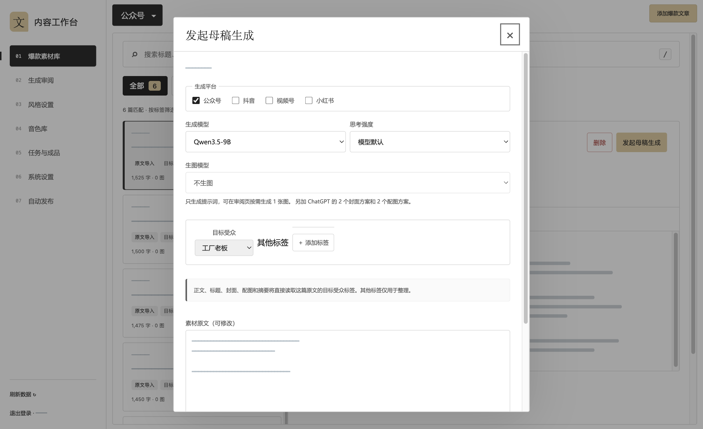
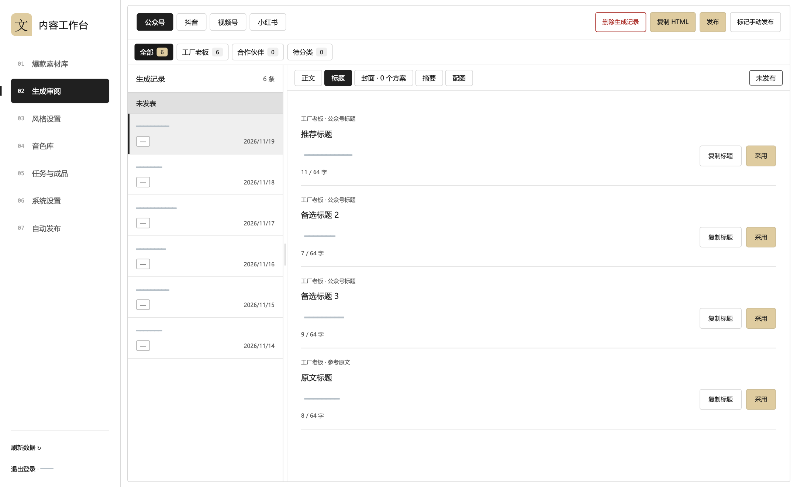

# CONTENTxNOW 内容工作台

把平时转发给自己的好文章，变成下一期公众号的选题库。在 CONTENTxNOW 里，你可以沿着一篇参考文章开稿，给自己的读者选正文、挑标题、配图，再把排好版的成稿送到要发布的公众号。

## CONTENTxNOW 在线版即将开放

CONTENTxNOW 正在准备面向大家开放的 SaaS 在线版。届时打开浏览器就能使用内容工作台。想提前体验，可以先[扫码加入微信交流群，预约体验资格](#微信交流群)。

## 从微信收藏到公众号发布

1. **看到好内容，先转发给自己。** 刷到一个好选题、一篇值得拆解的爆款，顺手转给自己的微信或「文件传输助手」。平时花几秒留下的参考，到做选题时就有了用处。
2. **一次整理，把整批文章收进素材库。** 导出这段聊天记录。如果拿到的是压缩包，先解压，把公众号文章链接整理到 Excel 或 CSV 的第一列。在「爆款素材库 → 添加爆款文章 → 链接导入」上传表格，也可以直接粘贴链接，每行一条。确认识别结果后，工作台会去重，逐篇采集原文和配图。手头已有文章 HTML 时，可直接选择多篇批量导入。
3. **挑一篇参考，定下自己的写作方向。** 在素材库里打开文章，点「发起母稿生成」，选好目标读者，再写下这次的要求。例如：「写给第一次接触这个话题的人。保留原文提出的问题，用我提供的门店案例来讲，结尾留一个读者愿意回答的问题。」
4. **正文、标题、摘要和图片，分别挑最合适的。** 同一选题可以比较多版正文，再从候选标题和摘要里选出最贴合的一组。启用生图模型后，封面和文中配图也有多套候选可挑。喜欢第一版的正文、第二版的标题和另一张封面，就按这个组合定稿。
5. **选好公众号，把整篇成稿送进草稿箱。** 工作台支持绑定多个公众号，每次发布时选目标账号。点击「发布」并确认后，CONTENTxNOW 通过微信官方 API 填好标题、摘要和排版后的正文，也把选定的封面和文中配图上传到微信。打开目标账号的草稿箱，就能看到完整图文。

**最后一步，按账号权限选择发表方式。** 未认证公众号也可以在完成开发配置、具备草稿和素材接口权限后上传草稿，再登录[微信公众平台](https://mp.weixin.qq.com/)打开草稿箱，预览并手动发表。回到 CONTENTxNOW 点「标记手动发布」，即可记录进度。具备发布接口权限的账号可以在工作台审阅草稿后立即发表，或设置定时发表，由工作台到点提交。微信对公众号的发布接口要求企业主体已认证，具体以目标账号的接口权限为准。[微信草稿接口说明](https://developers.weixin.qq.com/doc/service/api/draftbox/draftmanage/api_draft_add.html) · [微信发布接口说明](https://developers.weixin.qq.com/doc/service/api/public/api_freepublish_submit.html)

## 工作台截图

以下截图使用匿名示例数据，灰线代替账号、文章标题和正文。

**素材库**按标签筛选文章，可在同一页切换 Markdown 与 HTML 原文。

**母稿生成**可以从选中的素材发起，选择发布平台、生成模型和目标受众。

**生成审阅**集中展示推荐标题和备选标题，编辑可以复制或采用选中的版本。

## 企业本地模型

企业独立部署版可连接本机或内网的 OpenAI 兼容模型服务。管理员指定模型地址和已加载的模型 ID，编辑即可在生成页面选择该模型。模型服务须提供模型列表、聊天补全和 JSON 结构化输出。分析原文配图还需要视觉模型。

本地模式把推理请求直接交给企业配置的服务，连接失败会提示重试。使用企业本地算力的推理不经过平台钱包。使用托管模型的团队可以在统一门户查看模型消费记录。

## 版本与授权

[查看 v1.0.0 发行说明](https://github.com/charleswongapp/CONTENTxNOW/releases/tag/v1.0.0)。本仓库公开产品说明和版本记录。核心软件闭源，企业可联系获取内部自用部署授权。未经另行书面授权，禁止将自有软件打包售卖、转授权或用于对外提供商业服务。

## 接下来的内容形式

**贴图号内容、小红书笔记、短视频的自动生成**已列入开发计划。欢迎[加入交流群](#微信交流群)，告诉我们你最想先做哪一种内容。

## 开发预告 · STREAMxNOW AI 直播平台

STREAMxNOW 正在开发，即将开放。它面向希望用一台电脑开播的主播，开发方向包括防识别、实时互动、语音克隆，以及实景与数字人同屏直播。

在导播台，你可以手动把一段话术关联到对应的视频素材。开播后，两条时间线实时显示话术讲到哪里、视频播到哪里。需要临时讲解某件商品时，可以插播关联的话术和画面。

## 微信交流群

用微信扫描下方二维码进群，可预约 CONTENTxNOW 在线版提前体验资格，也可以交流内容工作流和企业部署。

